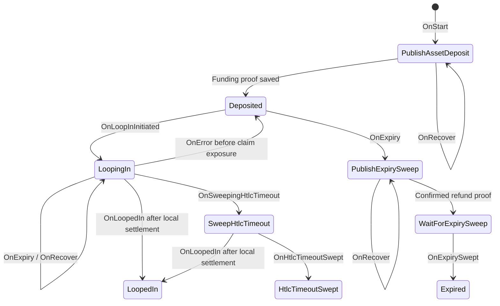

# Asset deposits in the ordinary deposit FSM

Asset deposits use `deposit.Deposit`, its normal SQL store and `deposit.FSM`.
`Asset` holds native quantities, the contract and proof. `Value` remains the
Bitcoin anchor value; `SwapHash` and the ordinary state own reservation and
finality. Bitcoin-only selection excludes typed asset deposits.

Creation builds a complete signed package and saves it in `AssetTx` before
publication. The initial `PublishAssetDeposit` action publishes through tapd
and waits for its proof. Startup recovery resumes the action, which retries the
same package independently of block notification delivery. The completed
metadata and `Deposited` state are saved together.
There is no funding plan journal or separate asset request worker.

The ordinary expiry actions build and save an asset CSV refund, publish it
through tapd and require its confirmed proof before `Expired`. The same
`AssetTx` field retains that completed refund across restarts. Withdrawal and
channel-opening events remain unavailable for assets.

While `LoopingIn`, the associated swap FSM owns recovery. Deposit CSV expiry
cannot race a potentially exposed swap claim. The swap may release the deposit
with `OnError` only before exposure; later errors retain ownership until its
payment and contract outcome resolve. See the
[Loop In mapping](../loopin/asset-fsm.md) for those actions.
