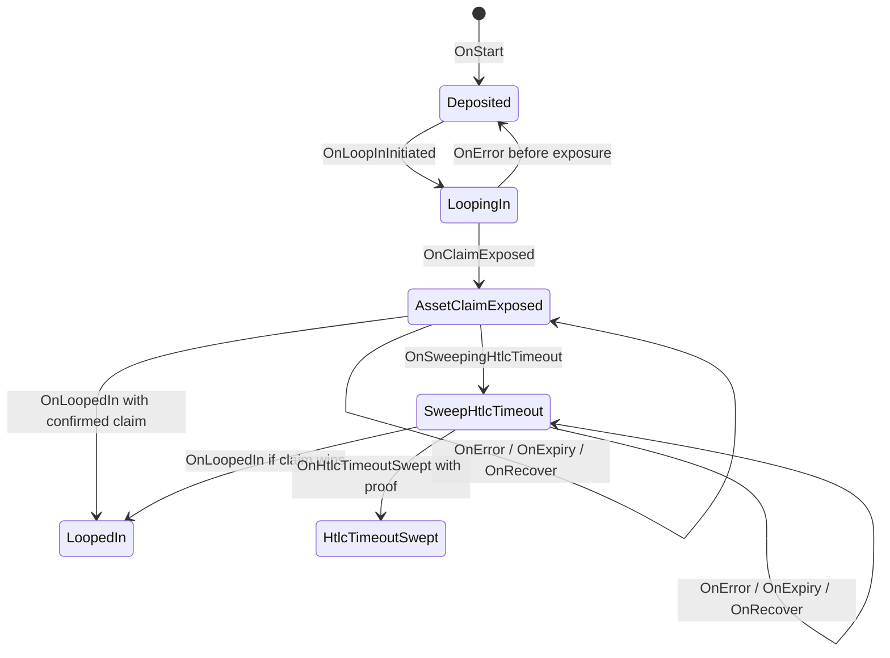

# Asset state transitions

The [generated Bitcoin diagram](fsm.md) is unchanged. `deposit/flow` owns the transition
names and graph; the legacy deposit FSM binds its wallet actions to that graph.
The asset execution journal uses the `ServerAsset` variant, shown afterward.
Ownership, atomic deposit reservations, and verified chain evidence remain
responsibilities of the caller and shared deposit manager.

The asset variant keeps the existing reservation and terminal state names.
It adds an explicit exposure barrier before signatures can leave the client.
Generic failure, restart, or expiry after that barrier keeps the deposits
reserved. Only a confirmed asset claim or refund can finalize them; no event
routes to the Bitcoin-only expiry, withdrawal, or channel-opening actions.

This shared graph does not register asset deposits in the production inventory
or replace the shared manager's exclusion with Bitcoin swaps and withdrawals.
The asset coordinator must still call that manager through its reservation
adapter before exposing signatures.
