# Asset state transitions

The [generated Bitcoin diagram](fsm.md) describes the ordinary FSM. The diagram
below describes the separate [asset controller](assetexec/README.md), which
currently shares state names but does not instantiate that FSM. The
[architecture audit](../../docs/asset-loop-in-architecture.md) maps these
operations to normal actions and identifies the added durability to remove:

```mermaid
stateDiagram-v2
    [*] --> InitHtlcTx: Persist offer and invoice intent
    InitHtlcTx --> SignHtlcTx: Persist HOLD invoice and RFQ
    SignHtlcTx --> SignHtlcTx: Verify and persist full SDK fallback
    SignHtlcTx --> MonitorInvoiceAndHtlcTx: Local accepted HTLC and durable exposure
    MonitorInvoiceAndHtlcTx --> PaymentReceived: Persist preimage and observe local settlement
    MonitorInvoiceAndHtlcTx --> SweepHtlcTimeout: Offer or refund deadline; drive SDK recovery
    SweepHtlcTimeout --> PaymentReceived: Recover preimage and observe local settlement
    SweepHtlcTimeout --> HtlcTimeoutSwept: Confirm refund and spendable asset proofs
    PaymentReceived --> Succeeded: Confirm claim and asset proofs
    InitHtlcTx --> Failed: Cancel before signature exposure
    SignHtlcTx --> Failed: Cancel before signature exposure
```

RPC errors preserve the durable state. After exposure, neither an elapsed
refund height nor server unavailability permits releasing deposits. Terminal
cleanup commits its execution checkpoint, deposit history and ownership-scoped
release in one transaction in the normal SQL store.

Both graphs are implemented in `loopin/flow`, selected by protocol. The Bitcoin
FSM binds its existing actions to `BitcoinV0`; the durable asset controller
uses `ServerAsset` for event dispatch, recovery routing, and journal transition
validation. The asset journal also advances the shared `deposit/flow` lifecycle
atomically with exposure and confirmed outcome evidence. See
[the deposit FSM](../deposit/asset-fsm.md). The write-ahead journal remains the effect
authorization boundary; an in-memory transition alone cannot expose signatures.

The existing `loopin.Manager` schedules both Bitcoin recovery and bounded asset
batches. Asset metadata lives on normal deposit rows; one SQL request row owns
the pre-offer request and subsequent execution record. This remains a second lifecycle. The planned integration uses explicit writes
in normal FSM actions before exposing signatures, following the existing
server payment action; a separate controller is not required.
