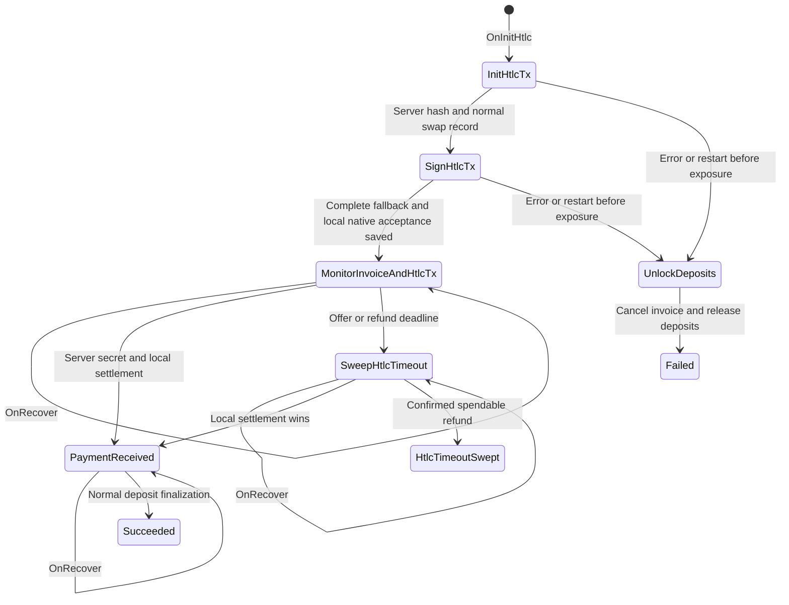

# Asset Loop In states

`NewFSM` selects asset actions in the ordinary static Loop In state map.
`Manager.recoverLoopIns` loads these swaps from the ordinary SQL store and
sends `OnRecover`, as it does for Bitcoin swaps. There is no asset controller,
request journal, recovery worker, or second transition graph.

The completed fallback, accepted native HTLC evidence and monitoring state are
saved together with an explicit checked `UpdateLoopIn` before the client sends
conditional claim signatures. This is the protocol boundary needed for
unilateral recovery. Other state changes use the existing FSM persistence
hook. There are no revision counters or a second set of lifecycle flags.

Recovery from either initial signing state aborts the unexposed attempt.
Recovery from monitoring keeps the saved fallback, checks the local invoice,
and rechecks the accepted asset circuit before resending claim signatures.
The server alone decides when to disclose its secret. The client can also
recover that secret from a verified on-chain success witness.

Client success requires local settlement of the same accepted group, amount
and HTLC. It does not wait for the server's claim confirmation. After exposure,
a deadline or RPC error cannot release deposits: timeout recovery must produce
a confirmed spendable asset refund. An unavailable server does not block the
local recovery path. A refund proof report is best effort; it is not a second
durable reporting workflow.

Asset deposits use the [normal deposit FSM](../deposit/asset-fsm.md). Their
`LoopingIn` state disables the original CSV expiry action while the swap owns
recovery. Normal deposit transitions handle cancellation, paid swaps and HTLC
refunds.
