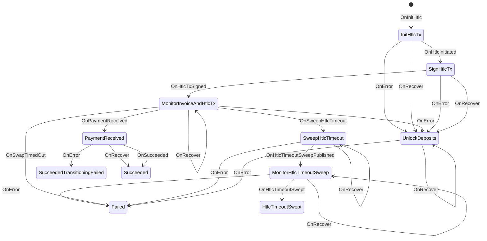

The Bitcoin diagram above retains its existing client-preimage behavior. The
[asset execution controller](assetexec/README.md) reuses these lifecycle names
with durable server-preimage boundaries:

```mermaid
stateDiagram-v2
    [*] --> InitHtlcTx: Persist offer and invoice intent
    InitHtlcTx --> SignHtlcTx: Persist HOLD invoice and RFQ
    SignHtlcTx --> SignHtlcTx: Verify and persist full SDK fallback
    SignHtlcTx --> MonitorInvoiceAndHtlcTx: Local accepted HTLC and durable exposure
    MonitorInvoiceAndHtlcTx --> PaymentReceived: Persist preimage and observe local settlement
    MonitorInvoiceAndHtlcTx --> SweepHtlcTimeout: Offer or refund deadline; drive SDK recovery
    SweepHtlcTimeout --> PaymentReceived: Recover preimage and observe local settlement
    SweepHtlcTimeout --> HtlcTimeoutSwept: Confirm refund and spendable asset proofs
    PaymentReceived --> Succeeded: Confirm claim and asset proofs
    InitHtlcTx --> Failed: Cancel before signature exposure
    SignHtlcTx --> Failed: Cancel before signature exposure
```

RPC errors preserve the durable state. After exposure, neither an elapsed
refund height nor server unavailability permits releasing deposits. Terminal
cleanup retries until the shared deposit manager confirms ownership-scoped
release. Cooperative signatures require a fresh local settlement check.

Both graphs are implemented in `loopin/flow`, selected by protocol. The Bitcoin
FSM binds its existing actions to `BitcoinV0`; the durable asset controller
uses `ServerAsset` for event dispatch, recovery routing, and journal transition
validation. The asset journal also advances the shared `deposit/flow` lifecycle
atomically with exposure and confirmed outcome evidence. See
[the deposit FSM](../deposit/fsm.md). The write-ahead journal remains the effect
authorization boundary; an in-memory transition alone cannot expose signatures.
