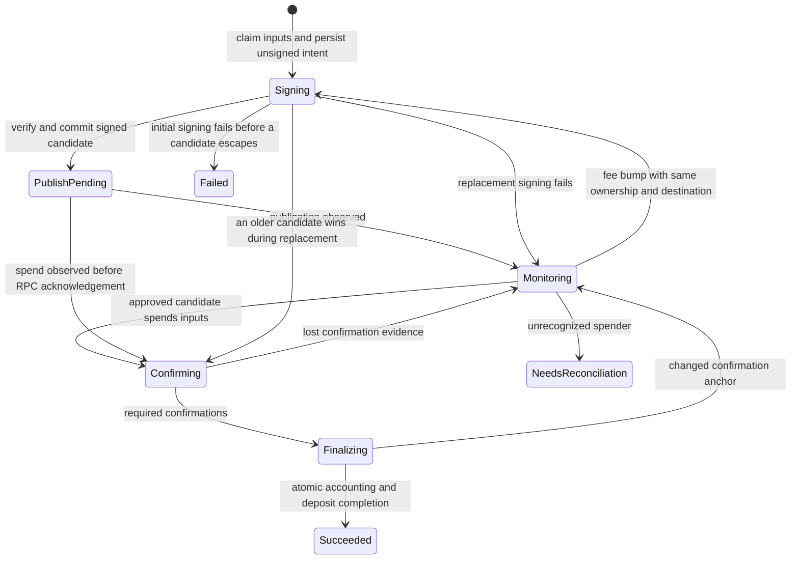

# Durable static-address withdrawals

The withdrawal manager uses `fsm/v2` for one authoritative workflow per stable
withdrawal ID. The ID and deposit membership remain fixed across fee bumps;
transaction IDs identify attempts, not separate withdrawals. Client RPC messages
and the server PSBT/public-nonce signing RPC are unchanged. Channel opening
continues to use `CreateFinalizedWithdrawalTx` as its existing signing helper.

## Lifecycle and persistence

A pure transition gate checks worker generation, the approved unsigned plan,
complete input membership, output values/scripts, replaceability, and all signed
witnesses. Every completed signing result must match the persisted plan. Chain
observations for an older retained candidate remain valid while a new attempt is
being signed; stale signing results do not. Finalization must match the exact
winning transaction, block hash and confirmation height in the durable snapshot.

The withdrawal domain store commits state, expected revision, membership,
exclusive active claims, deposit mirrors and transition history atomically.
`WorkflowStore` adapts that domain transaction to the generic FSM register; the
engine itself owns no database schema. The existing withdrawal tables are never
used as the active workflow authority.

The fully signed transaction and publication intent commit before broadcasting.
A lost publication response leaves a retryable obligation, not permission to
release deposits. Recovery republishes the exact stored bytes and restores spend
and confirmation subscriptions. All signed attempts remain available until the
winning chain spend resolves the withdrawal.

Deposits first enter `WithdrawalReserved`, which excludes competing loop-ins,
channel opens and withdrawals before signing. `Withdrawing` means a usable signed
transaction has been durably retained and may already have been broadcast. A
manager-side ownership gate holds deposit events through the domain transaction
and authoritative cache readback. Readback failure fences the cached deposit
until reconciliation succeeds. Generic legacy errors cannot unlock reserved or
signed withdrawal obligations.

Signing, publication and chain tracking run in supervised workers. Results return
to the manager as typed FSM events, after callbacks return. Signer sessions and
private nonces are ephemeral and are cleaned up; recovery negotiates fresh
sessions rather than replaying consumed nonces. Confirmation subscriptions retry
registration, errors and closed channels. Caller cancellation abandons only its
buffered reply wait; it does not cancel an accepted durable withdrawal.

The existing three-confirmation completion policy is retained. Finalization
checks the confirmation anchor again, atomically records the winning amounts and
marks all members withdrawn, then reconciles runtime state. As with the prior
client, chain reorganizations deeper than the configured completion policy need
operational reconciliation; the terminal FSM does not promise Bitcoin finality.
Run only one client daemon owner for a database. SQL revision checks protect
writes but are not distributed fencing of signers or external publishers.

## Domain migration and listing compatibility

Numbered migration 24 adds only `static_address_withdrawals_v2` and its member,
active-claim and history tables. It does not alter the legacy `withdrawals` or
`withdrawal_deposits` schema or contents.

Before any deposit FSM is activated, daemon initialization runs an idempotent
application import of all legacy rows and orphaned withdrawal evidence in one
transaction. Running this import after live deposit/expiry workers have started
is unsupported: their cached legacy state could authorize a competing effect.
The import processes records as follows:

- Completed historical summaries retain their original identity, accounting and
  confirmation details even when raw transaction bytes were never retained.
- A pending withdrawal is resumable only when its complete membership and common
  signed transaction are provable, including valid witnesses against the stored
  static-address funding script. Recovery never guesses a missing input or group.
- Incomplete, overlapping, malformed or conflicting evidence becomes a durable
  `NeedsReconciliation` record. Potentially encumbered deposits are quarantined;
  this state neither publishes unknown transactions nor unlocks their inputs.
  Conflicting non-withdrawal ownership is preserved while the withdrawal record
  remains quarantined; it is never overwritten by a historical summary.
- Artifact-bearing deposits and provable orphan clusters are imported even if
  legacy failures omitted the withdrawal row. Stable source keys make retries
  idempotent and preserve already-progressed workflows.
- Unambiguous completed members are repaired to `Withdrawn` atomically.
  Withdrawal startup reconciles imported historical and active records after
  deposit startup
  and before accepting new commands.

The client listing path reads only the new domain store and projects into the
unchanged `Withdrawal`/RPC response. Pending records with a known transaction ID remain listed, including legacy
transaction IDs retained only as historical facts. Imports without a representable
transaction ID remain durable and quarantined but cannot be represented by the
old listing RPC.
Legacy `SqlStore.CreateWithdrawal` and `UpdateWithdrawal` are deprecated and kept
for source compatibility and migration fixtures. New production workflows never
write them. An older binary does not understand the new workflow authority;
preserving the old tables is not a general database downgrade guarantee.

## Verification

Tests inject ambiguous commits, claim contention, history failures, cache readback
failures, partial legacy groups, conflicting memberships, canceled callers,
stale signing/finalization results, funding-plan tampering, closed subscriptions,
reorgs and process restarts. Migration tests verify the old rows are unchanged,
all old records remain represented, import retries are idempotent, and new-only
listings survive SQLite reopen. Shared store tests use the existing SQLite and
PostgreSQL test fixtures. Existing server integration cases exercise single- and
multi-input withdrawal restart, RBF, arbitrary amounts and deposit ownership.
